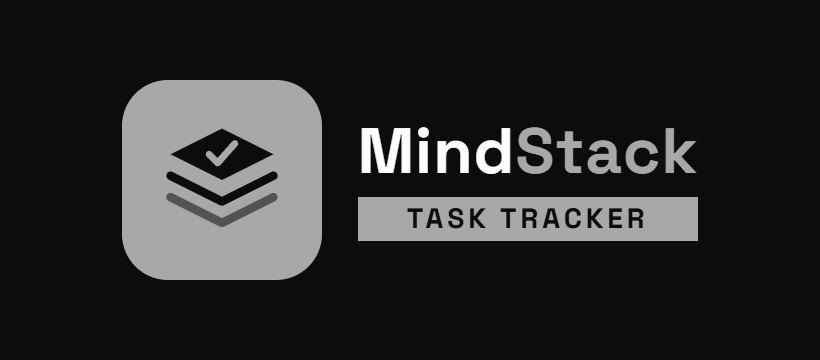

<p align="center">
  
</p>

<p align="center">
  A team task tracker for small teams and startups, built with Laravel.<br>
  Create a project, invite your team, and assign tasks to each other.
</p>

---

## Features

**Projects as private groups**
- Each project is a private group; you only see the projects you belong to
- Invite people with a link, or add an existing account by email
- The owner can remove members and delete the project; members can leave

**Board**
- Four columns: To Do, In Progress, In Review, Done
- Drag and drop with a mouse, or a "Move to" menu on touch screens
- Search, plus filters for My tasks, High priority and Overdue
- Cards show label, priority, checklist progress, comment count, assignee and due date

**Tasks**
- Priority, due date, label and assignee (any member of the project)
- Checklist with progress
- Comments

**Dashboard**
- Tasks assigned to you, and who they came from
- Counts by status, overdue count and a status breakdown
- Due this week, recent activity and team workload

**Works on phones**
- Top bar and bottom tab bar
- Board columns swipe sideways
- The task list becomes cards and forms stack into one column

## Tech stack

| Part | Used |
| --- | --- |
| Backend | Laravel 12, PHP 8.2+ |
| Database | SQLite by default; MySQL also works |
| Frontend | Blade templates, plain CSS, a little plain JavaScript |
| Build step | None. There is no npm build to run |

## Getting started

You need [PHP 8.2+](https://www.php.net/) and [Composer](https://getcomposer.org/).

```bash
# 1. Get the code
git clone https://github.com/YOUR-USERNAME/mindstack-task-tracker.git
cd mindstack-task-tracker

# 2. Install PHP packages
composer install

# 3. Create your own settings file and app key
cp .env.example .env        # on Windows: copy .env.example .env
php artisan key:generate

# 4. Create the database tables
php artisan migrate         # answer "yes" if asked to create the SQLite file

# 5. Start the app
php artisan serve
```

Open http://127.0.0.1:8000, choose **Create one** to register, then create your first project.

### Settings

Set your timezone in `.env` so due dates and the dashboard greeting use your local time:

```
APP_TIMEZONE=Asia/Singapore
```

To use MySQL instead of SQLite, change these in `.env` before running `php artisan migrate`:

```
DB_CONNECTION=mysql
DB_HOST=127.0.0.1
DB_PORT=3306
DB_DATABASE=your_database
DB_USERNAME=your_username
DB_PASSWORD=your_password
```

### Trying it on your phone

Run `php artisan serve --host=0.0.0.0`, then open `http://<your computer's IP address>:8000` on a phone connected to the same Wi-Fi.

## How to use it

1. **Create a project.** You become its owner.
2. **Invite your team.** Open the project, choose **Invite**, and send the link. Anyone who opens it and logs in or signs up joins the project.
3. **Add tasks.** Any member can create a task and assign it to any other member.
4. **Move tasks across the board** as work progresses.
5. **Check your dashboard** for tasks assigned to you and what is due this week.

## Project structure

| Path | What it holds |
| --- | --- |
| `routes/web.php` | All routes |
| `app/Models/` | `Project`, `Task`, `ChecklistItem`, `Comment`, `Activity` |
| `app/Http/Controllers/` | Login and registration, dashboard, projects, members, tasks, checklist, comments |
| `database/migrations/` | Database tables |
| `resources/views/` | Blade pages |
| `public/css/app.css` | Theme and phone layout; colours are variables at the top of the file |
| `public/js/board.js` | Drag and drop for the board |
| `public/images/` | Logo and app icon |

## Security notes

- `.env` holds your app key and database password. It is listed in `.gitignore` and must never be committed. Share `.env.example` instead.
- On a live server, set `APP_ENV=production` and `APP_DEBUG=false` in `.env`.
- Anyone with a project's invite link can join that project, so share links only with your team.
- The app does not send email. Invite links are shared by you.

## Known limits

- No email or push notifications when a task is assigned
- One label per task
- No file attachments

## Author

Built by MindStack Dev &amp; Tech.